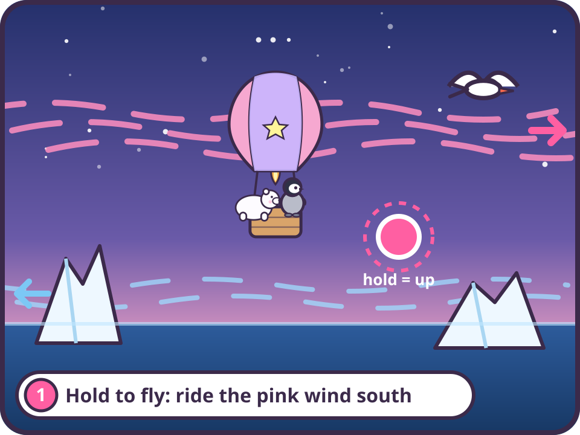
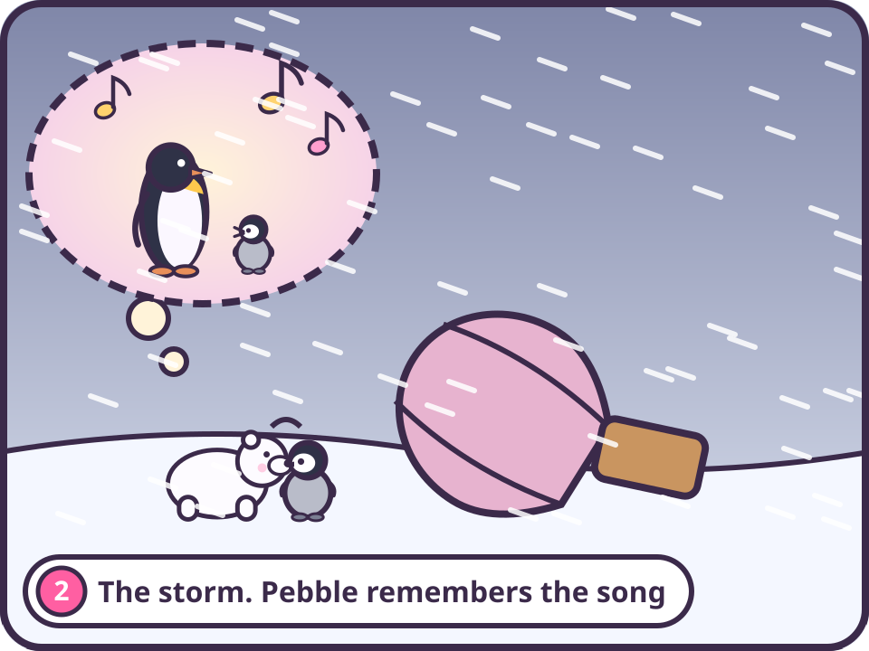
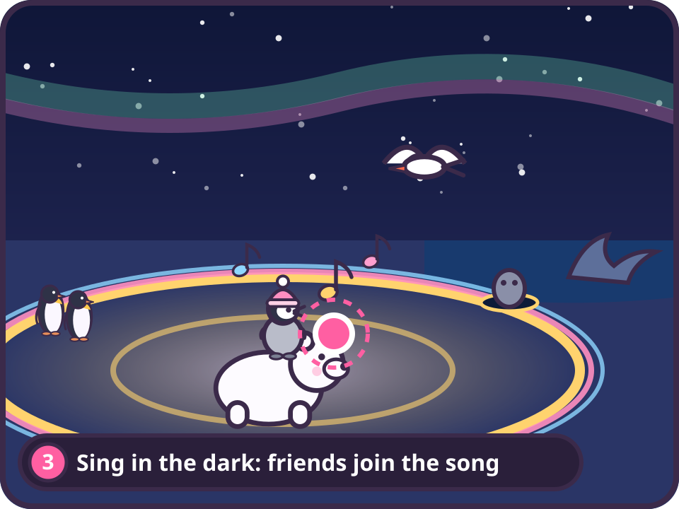
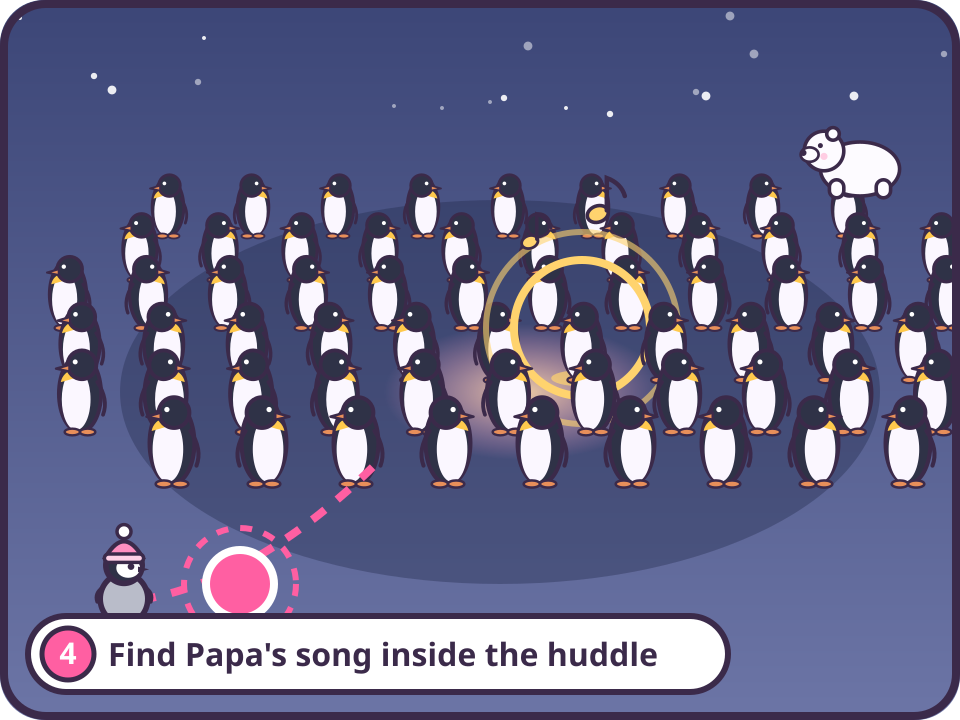
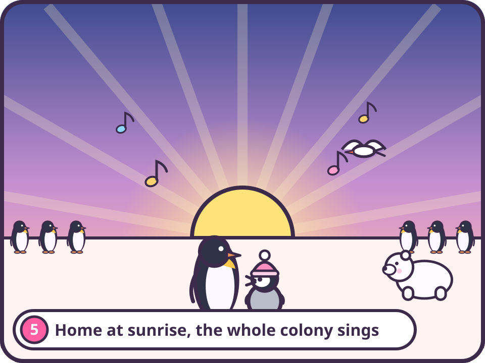
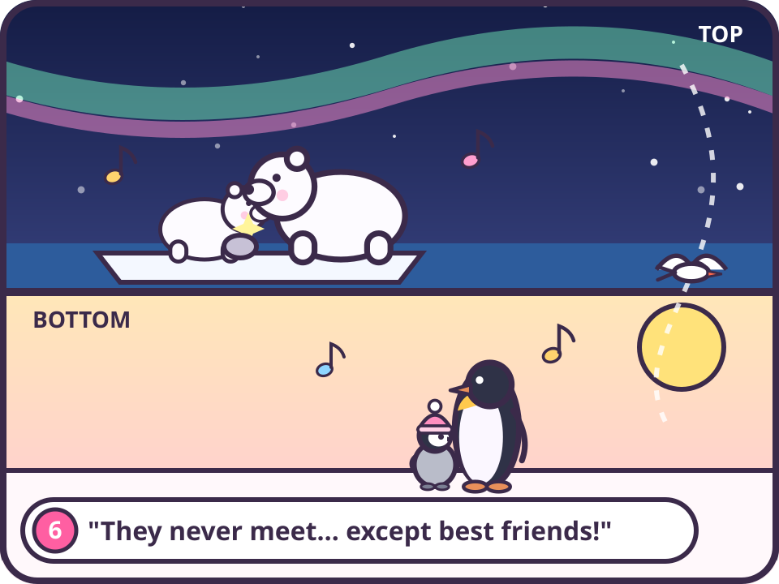

# 🌅 The Poles' new ending: The Longest Night (being built: Act 2 and the script are in, see poles.md, Next)

**The pitch:** the last stretch of Pebble's story becomes one 3D finale with a real third act. She flies Sparkle's
balloon down the world herself, a blizzard knocks it out of the sky, and Pebble remembers the song Papa taught him the
night he hatched. He's too small to be heard over the wind, so she sings it with him, and every friend from the story
joins in until the song is big enough to cross Antarctica. Papa sings back from inside a huddle of a thousand dads. She
leads Pebble through the huddle to him, and the sun comes up for the first time in months as they meet. Then Pola
goes home with a pebble to remember him by.

It replaces **Emperor Huddle** (the chapter) and **Home** (the finale: the flight, Papa's song, Terry's quiz). It keeps
what they teach and moves it into play.

|  |  |
|---|---|
|  |  |
|  |  |
|  |  |

## Why the current ending falls flat

- **The last game is a flashback.** The huddle is Papa remembering the hatch, so the story stops moving just before
  the end. Carrying dads into the middle is also the same move over and over.
- **Her hands aren't in the big moment.** Pebble and Papa meet in a film. What she does in the finale is pick a papa
  by ear three times, then answer eight quiz questions.
- **No third act.** Nothing goes wrong on the way home, so getting there doesn't feel like winning anything.
- **Pola's goodbye is a quiz answer** ("I'm home! Bye, Pebble!"), and most of the threads the story set up (the red
  ship, Mama's "friends help friends", the woolly hat, the singing seals and whales, "they never meet") are never
  picked up again.

## The shape

One chapter, three acts, a goodbye. Each act is a section with its own link. Films go between them, and every film can
be skipped with ⏭.

| | Beat | She does | Story | Learns by doing |
|---|---|---|---|---|
| 🎬 | **Time to fly** (film, ~40 s) | watches | The fox is white: winter. Mama's goodbye, Nari can't come south, the balloon lifts off. Meanwhile, Papa waits in the long night and hums his song into the wind. | Narwhals live only in the Arctic |
| 🎈 | **Act 1: Hold to Fly** `fly` (~2.5 min, ~35 touches) | **flies the balloon herself**: hold to heat the air and rise, let go to sink, find the pink wind that blows south | Down the world: the Arctic, the warm middle (the red ship!), the dark southern sea, then the blizzard | Hot air rises; balloons steer by finding the right wind; the warm middle; flat southern icebergs |
| 🎬 | **The storm** (film, ~40 s) | watches | The balloon comes down in a whiteout. Pebble loses hope. Pola: "Friends help friends." The memory: the night he hatched, Papa's song. "Then we'll ALL sing it!" | — |
| 🎶 | **Act 2: Sing in the Dark** `chorus` (~2.5 min, ~30 touches) | **holds Pebble to sing**: a glowing ring of song rolls out across the dark snow and lights up what it touches. Friends it finds join in, and the ring grows | Terry, a Weddell seal, the Adélies from the slide, a humpback whale: everyone sings Papa's song. The biggest song crosses Antarctica, and a gold answer comes back | Camouflage; seals and whales sing; penguins know family by their song |
| 🎬 | **So many papas** (film, ~20 s) | watches | The colony: a huddle of a thousand dads. "They all look the same!" Pola can't go in (the dads are shy of bears). "You can do it, Pebble." | — |
| 🐧 | **Act 3: Through the Huddle** `huddle` (~2 min, ~30 touches) | **leads Pebble through the huddle**: drag him along and the dads squish aside. Tap to sing, and Papa's gold notes rise from wherever he is now | The huddle churns, a gust rolls Pebble out, and the middle is packed. The biggest song: the dads turn, step aside, and the huddle opens like a flower. Her finger tucks Pebble onto Papa's feet. | Dads keep the egg on their feet and take turns in the cold; they don't eat all winter |
| 🌅 | **Sunrise** (film, ~50 s) | watches | The reunion as the first sun in months comes up. Papa meets a polar bear. Pola: "Friends help friends!" Everyone sings the song, the whole colony too. | Months of night, then the sun comes back |
| 🪨 | **Goodbye** `goodbye` (film ~30 s + ~40 s of play) | **flies Pola home** up the toy globe (hold to rise, the same move as Act 1) | Pebble gives Pola a pebble ("Penguins give pebbles to best friends"). Mama is waiting at the top. | Polar bears live in the north (the old quiz's first question, answered by flying) |
| 🎬 | **The end** (film, ~25 s) | watches | Top and bottom of the world at once: Pola with her pebble under the northern lights, Pebble under Papa in the sun, both humming the song. "They never meet..." "Except best friends!" Then the trophy. | When the sun rises at one pole, it sets at the other |

About **7 minutes of play and 3½ minutes of film**, close to today's huddle plus finale. Leave between acts and the
trail picks up at the next one.

## Every thread pays off

| Set up in... | ...pays off in the ending |
|---|---|
| **The way in**: Pebble fell asleep in a fish crate on the red ship | Act 1: the balloon passes the red ship sailing south. "That's how I got lost!" Pola: "No more fish crates for you!" |
| **The way in**: Terry knows the way | The storm: Terry can't see the way, so the song has to be the way. The end: "See you next year!" (terns fly it every year) |
| **Floe Hop**: "I can't swim yet, my feathers are too fluffy"; Pola carries him | Act 1: dip the basket into the sea and Pebble squeaks "Don't get me wet!" Act 2: she carries him through the dark. The colony film: she lets him go the last bit on his own |
| **Floe Hop's film**: Mama, "Friends help friends" | The storm: Pola says it to Pebble when he gives up. Sunrise: Pola says it to Papa. It's the moral of the whole story |
| **Narwhal Ride**: Nari, "Say hello to the bottom of the world for me!" | The opening film: Nari can't come (narwhals only live up north). The whale in Act 2 joins in for her |
| **Snow Coats**: white hides in white snow; the fox turns white when it's time to fly | The opening film: "The fox is white. Time to fly south!" Act 2: the song lights up Pola in the whiteout, and you can barely see her: camouflage |
| **Penguin Slide**: Papa asks the Adélies, finds a woolly hat ("It fits!"), meets a singing Weddell seal and a humpback | Act 2: the same Adélies, the seal and the whale sing in the chorus. Pebble finds the woolly hat in the snow, puts it on and says Papa's line: "It fits!" He wears it to the end |
| **Emperor Huddle (#474)**: Papa teaches Pebble his song the night he hatches, "Now you'll always find me" | The storm: that night comes back as a memory, using #474's hatch scene and recorded lines. Act 3 takes place inside the huddle #474 built |
| **The globe's sun toy**: summer at one pole is night at the other | Sunrise, then the end: sun at the bottom, night falling at the top |
| **The place's big fact**: polar bears and penguins never meet | The last line: "They never meet..." "...except best friends!" |
| **Sparkle**: "My balloon can carry Pebble home" | Act 1: she flies it. Goodbye: she flies Pola home in it |

## The Disney third act

The shape is the one the big animated films use, scaled down for a five-year-old:

1. **The journey home** (Act 1): the fun part. The world goes by and the friends crack jokes.
2. **All is lost** (the storm): the balloon is down, it's dark, and the hero is small. Pebble says it out loud: "How
   will I ever find Papa?"
3. **Remember** (the memory): what a parent once gave him is the answer. This is the "remember who you are" moment.
4. **Everyone helps** (Act 2): every friend from the story comes back for the climax, and the song gets bigger with
   each one. You can hear the chorus build.
5. **The last stretch alone** (Act 3): the friend who carried him all this way lets him go. She does the reunion with
   her own finger, not in a film.
6. **The reunion at dawn** (sunrise): the sun has been gone for months and comes back at the exact moment they meet.
7. **A bittersweet goodbye with a keepsake** (goodbye): the friends live at opposite ends of the world, and one gives
   the other something to remember them by.
8. **The reprise** (the end): the song plays once more, at both ends of the world at once, and the place's big fact
   gets turned around.

## One song, start to finish

Papa's song (`party/sounds.ts` `TUNES[0]`, the tune #474 teaches) is the ending's theme tune. It comes back in
every beat and grows each time:

| Where | How it sounds |
|---|---|
| The opening film | Papa hums it alone into the wind. Lonely, solo |
| Act 1 | Tap Pebble and he hums it in the basket. A small peep |
| The storm | Papa sings it to the newborn (memory, warm); then Pebble alone, and the wind swallows it |
| Act 2 | Each friend who joins adds a voice to the same tune: Terry's whistle, the seal's trill, the Adélies' honks, the whale's low moan. The biggest song is all of them together |
| Act 2's end, Act 3 | Papa's answer: one gold voice, far away, then closer |
| Sunrise | Everyone sings, then the whole colony hums it and the music swells (an ElevenLabs music cue) |
| The end | Two hums, one at each pole; then the trophy fanfare in the song's key |

## The three new toys

### Act 1, Hold to Fly: she's the balloon's pilot

- **Her finger:** hold anywhere and the burner roars, so the balloon rises; let go and it sinks slowly. Click and hold
  on a Mac. It's fun with no goal: whoosh up, float down, skim the sea.
- **The trick (a real one):** a balloon can't steer. It finds a wind going the right way. Winds blow at two heights,
  and you can see them as ribbons of streaks: **pink blows south** (fast, Terry rides it), **blue blows back north**
  (slow). She learns the idea by doing it: go up to go fast.
- **Grows three times:** 🧊 the Arctic (bergs to hop over, Nari waves, a walrus to skim past) → ☀️ the warm middle
  (a thundercloud to rise over or splash through, the red ship below, a whale spout to dip down to) → 🌌 the southern
  night (the sky darkens, the southern lights, huge flat bergs, then the blizzard: gusts push her down, so she holds
  harder).
- **Silly:** hold too long and the balloon pokes into a cloud ("I can't see! It's all fluffy!"). Let go too long and
  the basket dips in the sea ("Don't get me wet!"). Bump a berg: boing.
- **Never fails:** the balloon always drifts south, just slowly in the blue wind. The pink ribbons get wider after a
  slow stretch. The landing in the storm is the story, not her mistake.
- **Pokeables:** Pola, Pebble (hums the song), Terry, the burner, the ribbons, the red ship, the whale, the albatross,
  the lights, the bergs.

### Act 2, Sing in the Dark: song you can see

- **Her finger:** hold on Pebble (he glows on Pola's back) and he sings. The longer she holds, the bigger the ring.
  Let go and a ring of light and notes rolls across the snow. Everything it passes lights up for a moment and
  reacts. A quick tap is a little peep and a little ring. It's sonar, but magic and pink.
- **Why it's new:** the dark *is* the level. She can't see what's out there until she sings, so every song is a small
  reveal (a snow lump turns out to be a snoring seal, a half-buried hat, Terry upside down in a drift).
- **Grows three times:** 🌨️ the whiteout (Terry joins and the ring gets a blue band; Pola camouflaged; the woolly hat)
  → 🌊 the ice edge (the Weddell seal, the slide's Adélies, a humpback: each adds a band and a voice; a leopard seal
  sings one wobbly note) → 🌈 everyone together: one long hold, the rainbow ring rolls over the hills to the colony,
  silence, then a gold ring comes back. Papa.
- **Pola walks on her own** after each new friend joins (the camera moves on), so her hands only sing.
- **Silly:** tap-tap-tap makes hiccup peeps. Sing right at Pola and she sings back a growly bear version ("Grr-la-la!").
- **Never fails:** a friend she hasn't found gets bigger and brighter with each ring. After a few rings they answer
  even a peep.

### Act 3, Through the Huddle: lead Pebble to Papa

- **Her finger:** drag Pebble and he waddles after it (flick, and he tummy-slides). The huddle is soft: dads squish
  aside, honk and shuffle back (#474's packing). **Side verb:** tap Pebble to sing, and Papa's gold notes rise from
  wherever he is right now.
- **Grows three times:** 🐧 the edge (Papa is near, but the huddle shuffles him away just as Pebble gets close; a dad
  lifts his belly and there's an egg) → 💨 the churn and the wind (a gust rolls Pebble back out; the dads on the edge
  shiver and take their turn in the middle) → 💛 the warm middle (packed tight; the biggest song, with the friends
  outside joining in from afar; the dads turn one by one and open an aisle; she drags Pebble the last steps onto
  Papa's feet, and Papa folds his belly over him).
- **Silly:** walk Pebble into a dad's tummy and he bounces off ("Hmph!"). Pola peeks over the huddle and waves at
  the shy penguins.
- **Never fails:** a drag toward the gold notes gets a gentle pull that way, the churn slows after a miss, and the
  gold notes stay up longer each time.

### Goodbye: one more flight

The toy globe from the hub. Hold to rise (Act 1's move), and the balloon climbs from the bottom of the world, through
the warm middle, to the top, where Mama Bear is waiting. About 10 holds and 40 seconds. Terry asks the old quiz's
first question, "Where do polar bears live?", and she answers by flying there.

## The script

**Key:** 🆕 new line · ♻️ already recorded (its key) · 🔁 recorded on #474's branch. Sparkle's lines have no speaker
name; she gives the instructions. Every gesture line comes in a touch and a mouse version (rule 2). No player name
anywhere (rule 5). All lines are under about 3 seconds.

### 🎬 Film 1 · `night-in` · Time to fly (~40 s)

> *The autumn tundra under fresh snow. The Arctic fox, all white now, pounces in a drift.*

- **Terry:** Snow! The fox is white. Time to fly south! 🆕
- *Mama Bear hugs Pola at the balloon.*
- **Mama:** Goodbye, my brave cub! Hurry home! ♻️ `story.homeIn.bye`
- **Pola:** I'll come back, Mama. I promise. 🆕
- *The balloon lifts. At the ice edge, Nari bursts up and spins.*
- **Nari:** Narwhals stay up north. Say hi to the south for me! 🆕
- All aboard! Next stop, the bottom of the world! ♻️ `story.homeIn.aboard`
- *The camera follows the balloon down the little globe into darkness.* Meanwhile, at the bottom of the world...
  ♻️ `story.slideIn.meanwhile`
- *The long night. Wind. A huddle of dads steaming under the stars. Papa stands at the windy edge, looking up.*
- **Papa:** I'll wait right here, Pebble. ♻️ `story.huddleIn.wait`
- *He hums his song into the wind, alone. The wind carries it away. Cut to the balloon.*

### 🎈 Act 1 · `fly` · Hold to Fly

| When | Line |
|---|---|
| The game opens (Sparkle) | 🆕 Hold your finger down to fly up! / Click and hold to fly up! |
| The first pink ribbon (Sparkle) | 🆕 Ride the pink wind south! |
| Stuck ~8 s, no hold (Sparkle) | 🆕 Hold your finger down to go up! / Click and hold to go up! |
| Terry, at the start | 🆕 **Terry:** Follow me! The pink wind goes south! |
| First rise (Sparkle, once) | 🆕 Hot air goes up, up, up! |
| She taps Pebble (first time, then he just hums the song) | 🆕 **Pebble:** This is Papa's song. Hmm hm hmm! |
| Into a cloud (silly) | 🆕 **Pola:** I can't see! It's all fluffy! |
| The basket dips in the sea (silly) | 🆕 **Pebble:** Don't get me wet! I'm too fluffy! |
| The warm middle | ♻️ **Pola:** Phew! I'm melting! `party.warm` |
| (Sparkle, after) | ♻️ The middle of the world is the warmest part! `party.warmFact` |
| Through the thundercloud (silly) | 🆕 **Pola:** Ahh! A cool shower! |
| The red ship below | 🆕 **Pebble:** The red ship! That's how I got lost! |
| | 🆕 **Pola:** No more fish crates for you! |
| A whale spouts | ♻️ **Terry:** Look down! A whale! `party.whale` |
| Over a country in her passport (once) | ♻️ **Terry:** Hello, Thailand! (and the others) `party.hello.*` |
| The cold comes back | ♻️ **Pebble:** It smells like home! `party.south` |
| The albatross | ♻️ **Terry:** Hello, albatross! Nearly there! `party.albatross` |
| The blizzard starts | 🆕 **Terry:** Hold on! A big storm! |
| (Sparkle) | 🆕 Hold your finger down! Keep the balloon up! / Click and hold! Keep the balloon up! |
| **Pokes** (Sparkle, the first time each) | 🆕 the balloon: "Hot air is light, so it floats up!" · 🆕 the ribbons: "Balloons steer by finding the right wind." · 🆕 a flat berg: "Southern icebergs are big and flat, like tables!" · ♻️ the lights: `hub.pokes.lightsSouth` · ♻️ the ship: `hub.pokes.ship` |
| Taps on the friends (in turn) | ♻️ `party.balloon` (Pola "Wheee!", Pebble "Higher, higher!") · ♻️ `hub.terry` |

### 🎬 Film 2 · `night-lost` · The storm (~40 s)

> *A gust. The flame gutters out. The balloon sinks softly into deep snow and tips over. White everywhere; the wind
> howls.*

- **Terry:** I can't see the way! 🆕
- *Pebble, very small in the snow.*
- **Pebble:** How will I ever find Papa? 🆕
- *Pola wraps him in a hug.*
- **Pola:** Friends help friends. Mama said so. 🆕
- *Pebble looks up. The storybook look: the night he hatched (#474's hatch scene). Papa bends down to the
  newborn.*
- **Papa:** Listen, Pebble. This is my song. 🔁 `huddle.papa.song`
- *Papa sings. Baby Pebble peeps it back.*
- **Papa:** That's it! Now you'll always find me. 🔁 `huddle.papa.always`
- *Back in the storm.*
- **Pebble:** Papa's song! I'll sing it! 🆕
- *He peeps it, tiny. The wind tears the notes away.*
- **Pebble:** It's too windy. He can't hear me. 🆕
- *Pola stands up tall, Terry on her head.*
- **Pola:** Then we'll ALL sing it! 🆕

### 🎶 Act 2 · `chorus` · Sing in the Dark

| When | Line |
|---|---|
| The game opens (Sparkle) | 🆕 Hold Pebble to sing! / Click and hold Pebble to sing! |
| Stuck ~8 s (Sparkle) | the same line again |
| First ring rolls out (Sparkle, once) | 🆕 Look! The song lights up the dark! |
| The ring finds Pola, white in the white (Sparkle, once) | 🆕 Pola is white like the snow. Camouflage! |
| The ring finds the woolly hat; Pebble puts it on | 🆕 **Pebble:** A hat! It fits! |
| The ring finds Terry, upside down in a drift | 🆕 **Terry:** Kee-arr! I'll sing too! |
| The Weddell seal pops up and trills (Sparkle) | ♻️ Weddell seals sing. It sounds like outer space! `slide.facts.weddell` |
| The slide's Adélies hop up, honking | 🆕 **Pebble:** The penguins are singing too! |
| The humpback rises and sings (Sparkle) | 🆕 Humpback whales sing long, long songs! |
| The leopard seal sings one wobbly note (silly) | (no line: a gurgle and a grin) |
| She sings right at Pola (silly) | 🆕 **Pola:** Grr-la-la! |
| Everyone's found | 🆕 **Pola:** All together now! |
| (Sparkle) | 🆕 Hold Pebble for a long, long time! / Click and hold Pebble for a long, long time! |
| *The rainbow ring rolls over the hills to the colony. Silence. A gold ring comes back.* | 🆕 **Pebble:** That's Papa! He heard us! |
| **Pokes** | ♻️ the lights `hub.pokes.lightsSouth` · ♻️ Pola `party.song.pola` · 🆕 Terry: "Keep singing! I'm right here!" · the balloon (the flame puffs, no line) |

### 🎬 Film 3 · `night-colony` · So many papas (~20 s)

> *They follow the gold notes over a hill. Below, in the dark, a huddle of a thousand dads, steaming.*

- **Pola:** Whoa! So many penguins! 🆕
- **Pebble:** Papa? They all look the same! ♻️ `story.homeLand.same`
- *Gold notes rise from somewhere deep inside the huddle. The dads near Pola see her, squeeze closer together and
  shuffle away.*
- Penguins have never seen a polar bear. They're a little shy! ♻️ `party.song.colonyFact`
- *Pola kneels and lifts Pebble down from her back.*
- **Pola:** Go on, Pebble. You can do it. 🆕

### 🐧 Act 3 · `huddle` · Through the Huddle

| When | Line |
|---|---|
| The game opens (Sparkle) | 🆕 Pull Pebble along with your finger! / Click and drag Pebble along! |
| Then | 🆕 Tap Pebble to sing! / Click Pebble to sing! |
| Stuck ~8 s (Sparkle) | 🆕 Follow Papa's gold notes! |
| A dad lifts his belly: an egg (Sparkle, once) | ♻️ Emperor dads keep the egg warm on their feet! `huddle.facts.egg` |
| The huddle shuffles Papa away | 🆕 **Pebble:** Papa, wait! |
| A gust rolls Pebble out (Sparkle) | ♻️ Whoosh! Carry Pebble back to Papa. `huddle.blown` |
| (Pebble) | ♻️ **Pebble:** Whoa! Papa, help! `huddle.pebble.blown` |
| The edge dads swap into the middle (Sparkle, once) | 🆕 The dads take turns in the cold. Everyone gets warm! |
| She pokes a thin, sleepy dad (Sparkle, once) | 🔁 Emperor dads don't eat all winter. They just keep the egg warm! `huddle.facts.fast` |
| A flick: tummy slide (silly) | 🆕 **Pebble:** Wheee! Tummy slide! |
| Into a dad's tummy (silly) | (a bounce and a grumpy honk, no line) |
| The middle, packed tight (Sparkle) | 🆕 Sing, Pebble! As loud as you can! |
| *The big song; the friends outside join in; the dads turn and step aside, one by one.* | 🆕 **Papa** (far off, then close): Pebble? Is that you? |
| The aisle is open (Sparkle) | 🆕 Take Pebble to Papa! |
| **Pokes** | ♻️ `party.song.pola` (Pola waving over the huddle) · ♻️ `huddle.facts.night` · the dads honk their own songs |

### 🎬 Film 4 · `night-sunrise` · Sunrise (~50 s)

> *Pebble on Papa's feet. Papa looks down.*

- **Papa:** Pebble! My Pebble! ♻️ `story.homeReunion.pebble`
- **Pebble:** Papa! I went to the top of the world! ♻️ `story.homeReunion.papa`
- **Papa:** I heard your song. I knew you'd come. 🆕
- *A thin line of gold on the horizon. The first sunrise in months. Light runs across the snow, and every penguin
  lifts its head.*
- The sun! It's back after months of night! 🆕
- *Over the hill: Pola, Terry on her head. Far out, the whale spouts. A thousand dads gasp.*
- **Papa:** Goodness! What is THAT? ♻️ `story.homeLand.what`
- **Pola:** Hi! I'm a polar bear! ♻️ `story.homeLand.bear`
- **Pebble:** This is Pola. She carried me home. ♻️ `story.homeReunion.friend`
- **Papa:** A polar bear at the South Pole! Thank you, Pola. ♻️ `story.homeReunion.thanks`
- **Pola:** Friends help friends! 🆕
- *Papa sings his song. Pebble joins in. Pola growls along, Terry whistles, the whale sings far out, and then the
  whole colony hums it in the sunrise. The music swells.*

### 🪨 Goodbye · `goodbye` (film ~30 s, then play)

> *Morning. Pola looks north.*

- **Pola:** I have to go home now. Mama is waiting. 🆕
- **Pebble:** Wait! I have something for you. 🆕
- *He waddles off and comes back with a smooth round pebble in his beak.*
- **Pebble:** For you! Penguins give pebbles to best friends. 🆕
- **Pola:** I'll keep it forever. 🆕
- *Pola climbs into the basket. Cut to the toy globe.*

| When | Line |
|---|---|
| The globe (Terry) | ♻️ **Terry:** Take Pola home! Where do polar bears live? `party.ask.bear` |
| (Sparkle) | the Act 1 line: Hold your finger down to fly up! / Click and hold to fly up! |
| Over the warm middle | ♻️ **Pola:** Phew! I'm melting! `party.warm` (a second time is fine: it's a joke now) |
| At the top: Mama on the ice | 🆕 **Mama:** My brave cub! You came back! |
| | ♻️ **Pola:** I'm home! Bye, Pebble! `party.home` |
| Poke the pebble (Sparkle, once) | 🆕 Some penguins give pebbles to say I love you! |

### 🎬 Film 5 · `the-end` · Top and bottom (~25 s)

> *The screen splits. **Top:** night falling, the northern lights. Pola curled against Mama on the floe, the pebble in
> her paws. **Bottom:** the sun up, Pebble on Papa's feet in his pink woolly hat. Both hum Papa's song at the same
> time, one at each end of the world.*

- Polar bears live at the top of the world. 🆕
- Penguins live at the bottom. 🆕
- They never meet... 🆕
- **Pola** and **Pebble** (together, from the two ends of the world): Except best friends! 🆕 (recorded once each,
  played together)
- *Terry flies up the screen between them.*
- **Terry:** See you next year! 🆕
- → The shell's trophy ceremony: ♻️ "You did it! You won the Polar Explorer trophy!" `trophyWin`

**Count:** 62 new lines (a touch-and-mouse pair counts as one; "Except best friends!" is recorded twice), 34
reused from clips already on main, 3 from #474's branch. The old quiz's and song game's lines retire (listed below).

## What changes in the place

- **The trail:** floe → narwhal → coats → slide → **home** (the new finale). Emperor Huddle stops being its own
  chapter: its play, its facts and its song move inside the finale. Hub: `hub.next.huddle` goes, and the slide's
  "next" becomes the existing home line.
- **Stamps and stickers:** the finale earns the fifth stamp and the emperor chick sticker (`L.stickers.chick`), then
  the trophy.
- **Retired:** the round game of Papa's song (`party/song.ts`), Terry's quiz and badge (`party.quiz`, `party.ask.*`
  except `bear`, `party.miss.*`, `party.right`, `party.badge`), the films `huddle-in`, `huddle-out`, `home-in`,
  `home-land`, `home-reunion`. The quiz's facts aren't lost: each is something she now *does* (bear home = the goodbye
  flight, coldest = the blizzard, the tern = "See you next year", summer and winter = the end's split screen).
- **The movie ticket** stays at the end of the trail after the trophy.

## Building it (later, for the next session)

One toy, one branch (this one), check-ins as usual. Build the riskiest new verb first.

1. **Act 2 first: the song ring.** It's the new verb nobody has felt yet. Robot-play it on its own in the dark set:
   the ring is a ground decal (an expanding band in a shader on the snow) plus a light that travels with it; things
   inside the band light up and show their outline for about 1.2 s. Joiners are `story/actor.ts` Actors that follow.
   Each joiner adds a voice layer to `TUNES[0]` (`party/sounds.ts`). Knobs: hold-to-radius curve, ring speed, glow
   time (`?feel=1`).
2. **Act 1: the balloon.** A new world on `engine3d/View3D` with the `story/props.ts` balloon, `look/sky.ts` blended
   day → dusk → night, `look/sea.ts`, bergs from props. Physics: vertical speed toward lift while held and toward sink
   when not; south speed is set by the wind band at the balloon's height. Knobs: lift, sink, the two wind speeds, the
   band heights, gusts.
3. **Act 3: from #474.** `activities/huddle/world.ts` already packs, squishes and shuffles dads and has Papa, Pebble
   and the egg. New: Pebble led by drag (not carried), the churn (a slow rotation of who's on the edge), the gold
   notes, the aisle-opening shot and the tuck. Far dads as instances so a thousand stay cheap (the budget is Koh
   Samet's ~400k triangles).
4. **Films** on `story/stage.ts`: new sets for the blizzard (fog, driving snow) and the colony at dawn
   (`PolarSky.blend` night → dusk with a sun); the memory reuses the storybook look and #474's hatch staging; the end
   is two cameras, split.
5. **Goodbye:** `party/route.ts`'s flight over the toy globe, run bottom to top, with Act 1's hold-to-rise.
6. **Sounds** (ElevenLabs, `sfx` skill): burner roar, wind-ribbon whoosh, blizzard loop, soft crash in snow, the song
   ring's shimmer, whale song, Weddell trill, tern call, leopard seal gurgle, colony honks and shuffles, a sunrise
   swell and the colony's hum (music cues). Reuse the Poles' recorded clips where they exist.
7. **Lines:** add the 🆕 lines to `lines.ts` in play order; CI records them. Then the table read, the reel on the Mac,
   and Kaylee's playtest.

Watch for in her playtest: does she hold Pebble to sing without being shown twice; does the dark scare her (keep it
starry and warm-colored, never black); does she sit through the storm film; does she get Pebble through the huddle
without the pull; does she say "best friends" back at the end.

*Plan written 2026-11-16 at your request ("replace the ending completely, 3D, a Disney ending, new mechanics; plan and
script first"). Nothing is built yet. If you like it, #474's 3D huddle becomes Act 3 rather than shipping on its own.*
